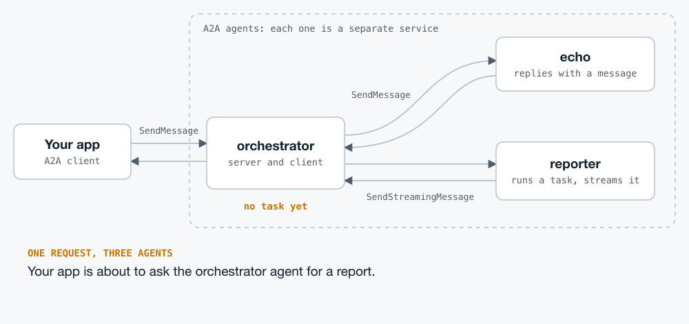
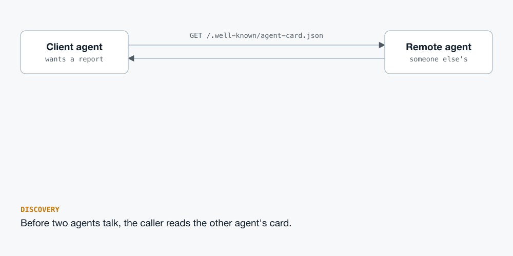
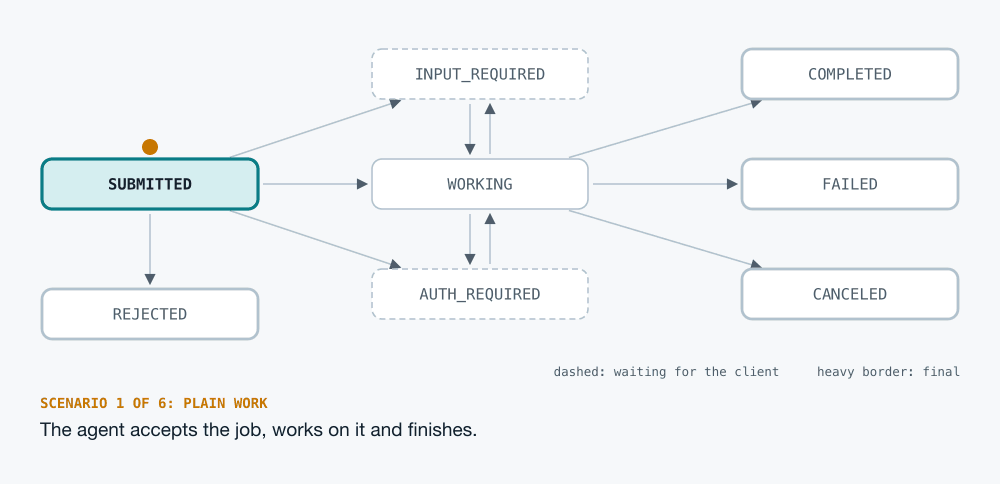
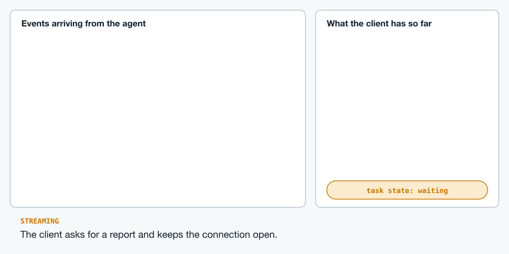
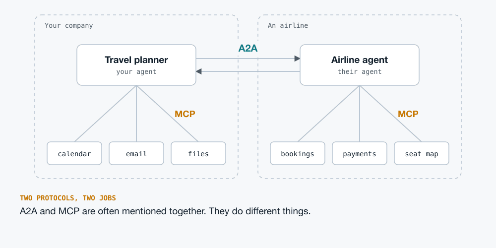
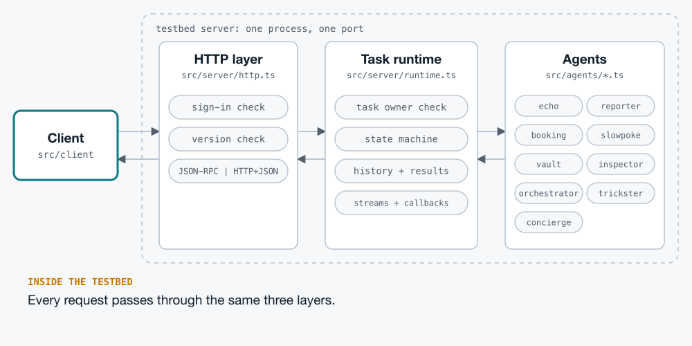
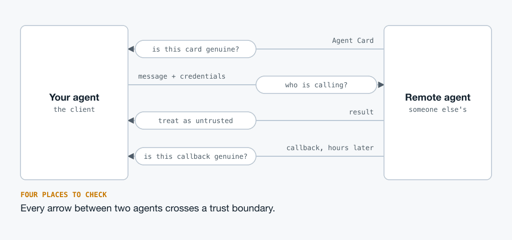

# A2A testbed

A hands-on lab for the **Agent2Agent (A2A) protocol v1.0**. Zero runtime dependencies: just Bun and TypeScript, so you can read every byte of the protocol instead of hiding it behind an SDK.

- **9 agents** that each demonstrate a different part of the protocol, one of them deliberately hostile
- **A client** that discovers agents from their Agent Cards and speaks both JSON-RPC and HTTP+JSON
- **13 narrated lessons** that print the actual HTTP traffic
- **70 tests**, most run against both bindings, as executable documentation



```bash
bun install
bun run lesson          # list lessons
bun run lesson 4        # run one (boots the testbed in-process if none is running)
bun run lessons         # run all 13
A2A_WIRE=0 bun run lessons   # hide the raw HTTP, keep the narration
bun test                # conformance suite
bun run serve           # standalone server on :4747 (curl it, point other clients at it)
```

(The default port is 4747. Override with `A2A_PORT`.)

## 60-second mental model

A2A lets **independent agents** (different vendors, frameworks, servers) collaborate **without sharing memory, tools or internals**. Each agent is an opaque HTTP service.

| Concept | What it is | Lesson |
|---|---|---|
| **Agent Card** | JSON at `/.well-known/agent-card.json`: identity, skills, capabilities, interfaces, auth. Fetch it first. | 1 |
| **Message** | One turn of conversation: `role` + `Part[]`. | 2 |
| **Task** | A unit of work with a lifecycle, created by the *agent* (not the client) when work takes time/state. | 3 |
| **Part** | `text` \| `raw` (base64) \| `url` \| `data` (any JSON), plus `mediaType`, `filename`. | 11 |
| **Artifact** | A task's *output*: named bundle of Parts, streamable in chunks. | 4, 11 |
| **contextId** | Groups messages/tasks into one conversation. Server-generated, client reuses it. | 2, 12 |
| **Streaming** | `SendStreamingMessage` / `SubscribeToTask` over SSE. | 4, 6 |
| **Push** | Server POSTs events to your webhook for long-running tasks. | 7 |
| **Bindings** | One data model, three transports: JSON-RPC, HTTP+JSON, gRPC. | 9 |

### Discovery



The card comes first. It tells the client what the agent can do and which address to send messages to (lesson 1).

### Task state machine



Six ways a task can go, each produced by one of the lab's agents. Dashed boxes are *interrupted* states: the task is alive and waits for the client to reply with the same `taskId`. Heavy borders are *terminal*: the task can never change again, so a follow-up is a new task that reuses the `contextId`.

### Streaming



The actual event sequence the `reporter` agent sends for `SendStreamingMessage`: the task first, then status updates and artifact chunks, ending on the final state (lesson 4).

### Where A2A fits next to MCP



MCP connects an agent to its own tools. A2A connects an agent to another agent, without either seeing inside the other.

### Message or Task?

SendMessage returns `{message}` **or** `{task}`. Quick answers (echo) → Message, no task ever exists. Anything with a lifecycle → Task. Callers must handle both.

## The agents (`src/agents/`)

| Agent | Shows | Try |
|---|---|---|
| `echo` | Message-only reply; `text/plain`-only input (content-type errors); no capabilities | lesson 2, 10 |
| `reporter` | Long-running task, status updates, **chunked artifacts** (`append`/`lastChunk`), FAILED (`explode`), push | 3, 4, 7 |
| `booking` | **INPUT_REQUIRED** multi-turn, history | 5 |
| `slowpoke` | Cancellation (real `AbortSignal`), resubscribe, polling | 6 |
| `vault` | Bearer auth for two identities (`testbed-token` = alice, `bob-token` = bob), **extended card**, **AUTH_REQUIRED** with a header credential, task ownership | 8, 13 |
| `inspector` | All four Part types, `*/*` input, **REJECTED** (`forbidden`) | 11 |
| `orchestrator` | **Agent-to-agent**: discovers, calls, streams from other agents | 12 |
| `trickster` | A **hostile** agent: harmless card, reply carries instructions aimed at the caller | 13 |
| `concierge` | Calls `trickster`; shows careless and careful handling of an untrusted reply | 13 |

Everything is mounted on one server at `/<agent>/`:

```
GET  /<agent>/.well-known/agent-card.json
POST /<agent>/rpc                       JSON-RPC 2.0 (method names: SendMessage, GetTask, …)
*    /<agent>/rest/message:send         HTTP+JSON (…/tasks/{id}, …/tasks/{id}:cancel, …)
```

## How the lab is built



Every request passes through the same three layers. The checks happen in the first two, so an agent is only ever one `execute()` function.

## Code map

```
a2a.proto                  normative spec (copied from a2aproject/A2A v1.0.0, Apache 2.0; see NOTICE)
examples/hello-agent.ts    a complete agent in one file, and hello-client.ts to call it
showcase.html              an animated one-page tour of the lab (open it in a browser)
docs/images/*.gif          the diagrams on this page
docs/diagrams/gifs.ts      draws them: `bun docs/diagrams/gifs.ts` (needs rsvg-convert and ffmpeg)
src/protocol.ts            types, state sets, error catalogue, helpers
src/server/runtime.ts      the state machine: tasks, history, streaming fan-out, cancel, push
src/server/http.ts         both bindings, SSE, auth gate, A2A-Version check
src/client/client.ts       discover(), every operation over either binding, SSE parser, foldStream()
src/agents/*.ts            write an agent = write execute(ctx) and call ctx.bus
src/server/callbacks.ts    which addresses the server will send callbacks to
src/client/webhook.ts      a callback receiver that verifies what it is sent
src/client/untrusted.ts    quarantine(), validateShape(): handling another agent's reply
src/lessons/*.ts           the 13 lessons
test/conformance.test.ts   the guarantees, as tests
```

**Writing your own agent** takes about 15 lines: copy `echo.ts` (Message) or `reporter.ts` (Task), add it to `src/agents/index.ts`, restart. The runtime handles everything else.

```ts
async execute({ message, bus, signal }) {
  bus.status("TASK_STATE_WORKING", "thinking…");          // creates the task (SUBMITTED first, automatically)
  bus.artifact({ artifactId: "a", parts: [{ text: "…" }] }, { lastChunk: true });
  bus.status("TASK_STATE_COMPLETED");                      // or bus.reply("…") for a bare Message
}
```

## Security (lesson 13)



Run `bun run lesson 13`. It walks the checks every A2A deployment needs, each one implemented here:

- **Who is calling.** Credentials are checked in `src/server/http.ts` before any agent code runs. Agents receive an identity (`ctx.principal`) and never a credential.
- **Credentials mid-task.** `AUTH_REQUIRED` is answered with an HTTP header (`X-Step-Up-Token`), verified by the web layer. A credential typed into a message is refused and stripped from stored history. A wrong one gets 403 and leaves the task untouched.
- **Whose task.** Every task has an owner. Get, list, cancel, subscribe, continue and callback settings all check it, and answer "not found" to anyone else.
- **Where callbacks go.** The server refuses internal addresses unless allow-listed (`A2A_CALLBACK_ALLOW`, default `127.0.0.1` for the lab's own receivers), requires https for public hosts and doesn't follow redirects. The receiver checks a per-receiver token and that the task is one it started.
- **What comes back.** `concierge` shows a reply from a hostile agent leaking a secret when pasted into a model's input, and leaking nothing when handled as data.

Limits to know about: agents without sign-in (everything except `vault`) treat all callers as one anonymous owner. The callback check reads the host name as written, so a public name that resolves to an internal address is not caught. There is no language model in the lab; a small stand-in function plays one in the `concierge` demo.

## Hand-driven experiments (agents running via `bun run serve`)

```bash
# Discovery
curl -s localhost:4747/reporter/.well-known/agent-card.json | jq

# JSON-RPC
curl -s localhost:4747/echo/rpc -H 'content-type: application/json' -H 'A2A-Version: 1.0' \
  -d '{"jsonrpc":"2.0","id":1,"method":"SendMessage","params":{"message":{"messageId":"m1","role":"ROLE_USER","parts":[{"text":"hi"}]}}}' | jq

# HTTP+JSON streaming (watch SSE events arrive)
curl -sN localhost:4747/reporter/rest/message:stream -H 'content-type: application/json' -H 'A2A-Version: 1.0' \
  -d '{"message":{"messageId":"m2","role":"ROLE_USER","parts":[{"text":"curl"}]}}'

# Auth
curl -s localhost:4747/vault/rest/extendedAgentCard -H 'Authorization: Bearer testbed-token' -H 'A2A-Version: 1.0' | jq '.skills[].id'
```

## Exercises

1. In lesson 4, remove the `break` so the abandoned stream finishes; then compare the event sequence with push deliveries in lesson 7. Same `StreamResponse`s, different delivery.
2. Add a `translator` agent that returns a `data` artifact, then make `orchestrator` call it too.
3. Make `reporter` honour `acceptedOutputModes` from the request configuration.
4. Send a message with `taskId` to a task that's still `WORKING`. This lab refuses it; the spec lets an agent accept it. Change the runtime to accept it and decide what the agent should do with the extra message.
5. Implement `tenant` routing (`/{tenant}/message:send`) in `src/server/http.ts`.
6. Point the client at someone else's real A2A agent: `A2AClient.discover("https://…")` works against any v1.0 agent.

## Fidelity notes (what's real, what's simplified)

Built on 2026-11-15 from the v1.0.0 spec text plus `a2a.proto`, and checked against the v1.0.0 text again after the first release. Where the prose and proto disagree, the proto won. (v1.0.1 came out in May 2026; its `a2a.proto` differs from v1.0.0 only in comments.)

**Faithful:** Agent Card shape (`supportedInterfaces`, `securitySchemes` in proto-oneof form), no `kind` discriminators, ProtoJSON enums, all 11 operations on both bindings, all 9 A2A error codes plus the 5 JSON-RPC ones, with the spec's status mapping and an `ErrorInfo` detail on both bindings (the tests trigger 11 of the 14; `InternalError`, `InvalidAgentResponseError` and `ExtensionSupportRequiredError` are defined but never provoked), SSE framing, `returnImmediately`, `historyLength`, ListTasks paging, idempotent push delete, terminal-immutability.

**Simplified / not implemented** (good extension projects):
- **gRPC binding.** `a2a.proto` is right there.
- Plain `http://` on localhost; the spec requires HTTPS in production.
- `tenant`, Agent Card **signatures**, **extensions** (`A2A-Extensions`), OAuth/OIDC/mTLS (only bearer is enforced; the others are declarable in the card).
- The `X-Step-Up-Token` header is this lab's invention. The spec says a credential asked for mid-task arrives out of band unless an extension agrees another way, and names no header. `X-A2A-Notification-Token` appears in a spec example but is not a required name; the spec's rule is that callbacks carry whatever the push config's `authentication` field asks for. This lab sends both: the token in that header, and an `Authorization` header when `authentication` is set.
- Version check is lenient: a missing `A2A-Version` is accepted as 1.0 (the spec treats it as 0.3).
- Streams close at *interrupted* states as well as terminal ones. The spec's HTTP+JSON section says the same; its auth section says an agent should keep the stream open in `AUTH_REQUIRED` when the credential arrives out of band. This lab always closes.
- A message sent to a task that is still `WORKING` is refused. The spec only forbids messages to *terminal* tasks; accepting them in other states is up to the agent.
- `SubscribeToTask` over HTTP+JSON is `GET` in the proto and `POST` in the spec prose. The server accepts both; the client sends `GET`.
- The callback address check is stricter than the spec, which only says agents *should* reject private addresses.
- In-memory task store: restarting loses all tasks.

For production, use an official SDK instead of this server (for JavaScript, `@a2a-js/sdk`, 1.3.0 at time of writing; there are also Python, Go, Java, .NET and Rust ones). This repo exists so you understand what it does for you.

## Licence

MIT for the code in this repository (see `LICENSE`). `a2a.proto` belongs to the A2A project and is Apache 2.0 (see `NOTICE`). This is an independent learning lab, not an official A2A project.

## Spec links

- https://a2a-protocol.org/latest/specification/
- https://github.com/a2aproject/A2A (proto at `specification/a2a.proto`)
